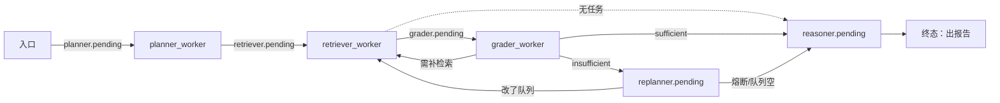

> 2026-10-18：当前持久执行权威是 agent_runtime；运行方法及限制见 [AGENT_RUNTIME.md](AGENT_RUNTIME.md)。新增工具策略、分支隔离、并行/重放契约见 [PARALLEL_AGENT.md](PARALLEL_AGENT.md)。下列旧五阶段 topic 及“默认全部调用 CHAIN”的历史说明仅用于兼容入口；新运行时按任务策略调用工具。

# 契约冻结（M0-T1）

> **这份文件的地位**：从 P0 起，下面每一条都是**接口契约**。
> 任何一条要改，必须同时改：本文件 + 全部实现 + 全部测试。
> 改完不更新本文件 = 契约漂移，视为 bug。

**冻结时间**：P0 阶段。**验证方式**：`tests/test_e2e_graph.py` + `tests/test_graph_vertex_names.py`
（契约不是写在文档里的愿望，是写在测试里的断言）。

---

## 契约 0 · 总原则

| 原则 | 含义 | 违反的后果（本项目已发生过） |
|---|---|---|
| **单一真源** | Prompt 只在 `prompts.py`；配置只在 `config.yaml`；图引擎只在 `dataset/graph.py` | 同一场景走不同链路行为不一致（阶段 3/4 各修了一次重复实现） |
| **失败要响** | 不许静默返回 `[]`/空串、不许吞异常 | DTW 静默过滤、检索静默 no-op、GMM 崩溃 —— 全是这一类 |
| **`compileall` 通过 ≠ 能跑** | 改完必须真的实例化/跑一遍 | 反复验证过 |
| **测试必须完全离线** | 不联网、不要 API key、不要 BGE-M3、不要 Kafka/Redis/Docker | 否则每次回归都不可重复 |

---

## 契约 1 · LangGraph 恢复语义 ⚠️ 最容易踩

**P0 spike（`spikes/spike_checkpoint_resume.py`）实证结论，6/6 通过：**

1. `interrupt()` 真的挂起，且**进程正常退出**（不是阻塞等待）→ 可以"进程常驻"也可以"挂起即退出"。
2. 检查点真的落盘到 sqlite（`checkpoints` 表非空）。
3. **另一个进程**重新打开同一个 sqlite + `Command(resume=...)` 可以从中断点续跑到 `END`。
4. ⚠️ **`interrupt()` 之前的代码在恢复时会重跑。**
5. ⚠️ **LangGraph 不提交"未完成节点"的状态增量** —— 所以恢复时 `state` 里
   **没有**上次留下的任何痕迹，节点是**从头**执行的。

**由 (4)(5) 推出的硬性约束：**

| 约束 | 做法 | 反面例子（spike 第一次跑就踩了） |
|---|---|---|
| 副作用必须**幂等** | 派发/写库/发消息前先查**外部**台账 | 靠 `state["started_tasks"]` 记"已派发" → 恢复后 `dispatch_count = 0`，重复派发 |
| **不许**用 `state` 记"我已经做过 X" | 用外部去重表（真实系统里就是"Kafka 生产者 + 去重表"） | 同上 |
| 断言要能区分"执行"和"生效" | 分别记录 `attempts`（每次调用）与 `dispatched`（唯一成功） | 只记一个数就看不出"重跑了 5 次但只派发 1 次" |

spike 里的正确形态：

```python
ledger.note_attempt(request_id)              # 每次都记 → 证明"节点确实重跑了"
if ledger.dispatch_once(request_id):         # 主键去重 → 证明"副作用只发生一次"
    bus.publish(...)
value = interrupt(payload)                   # 挂起点
return {"remote_result": value}
```

实测：节点执行 **5** 次、实际派发 **1** 次、总线任务 **1** 条。

> **P1 起，任何"调工具 / 发任务 / 写外部系统"的节点都必须遵守本条。**

---

## 契约 2 · `AgentState`（LangGraph 进程内状态）

位置：`multiple-search/soul.py::AgentState`（`TypedDict`）

| 字段 | 类型 | 归约 | 写入者 | 语义 |
|---|---|---|---|---|
| `user_query` | `str` | — | 外部 | **只读**。原始诉求，所有节点不得改写 |
| `task_queue` | `List[str \| dict]` | 覆盖 | Planner / Executor / Replanner | 待执行队列；**队首 = 下一步要做的**；空 = 可以出报告 |
| `past_observations` | `List[str]` | **`operator.add`** | Executor | 证据链。**只追加**，禁止整体赋值 |
| `global_facts` | `List[str]` | 覆盖（节点自己拼） | Executor | 防篡改事实池 |
| `retry_context` | `Dict[str, Any]` | 覆盖 | Executor / Replanner / ExecuteCode | 临时状态：`status` / `fail_count` / `sandbox_error` |
| `recursion_depth` | `int` | 覆盖 | L0 / Executor / Replanner | 熔断计数，> `agent.max_recursion_depth` 即 `force_stop` |
| `final_report` | `Optional[str]` | 覆盖 | Generate / InjectResult | 最终意见书 |
| `sandbox_session_id` | `Optional[str]` | 覆盖 | ExecuteCode / Cleanup | Docker 会话句柄；Cleanup 必须置 `None` |
| `generated_code` | `Optional[str]` | 覆盖 | WriteCode | 待执行的 Python 代码 |
| `calc_result` | `Optional[str]` | 覆盖 | ExecuteCode | 计算输出；**非空是"沙箱已完结"的权威判据** |
| `sandbox_retries` | `int` | 覆盖 | WriteCode / ExecuteCode | 沙箱重试次数 |
| `needs_sandbox_calc` | `bool` | 覆盖 | Generate | 是否需要算钱 |

**任务元素两种形态**（必须都支持）：

```python
# v2（新，优先）—— Executor / Replanner 的正规格式
{"task_desc": "...", "engine": "GRAPH_TRAVERSAL" | "GLOBAL_DENSE_WORMHOLE", "rationale": "..."}
# 旧字符串形态（兼容保留）
"[WORMHOLE] 检索词..."
```

> ⚠️ `past_observations` 是**归约字段**。测试里手工 `state.update(delta)` 会把它当覆盖写
> —— 取终态必须用 `stream_mode="values"`，交给 LangGraph 做归约（`tests/harness.py` 已这么做）。

---

## 契约 3 · 持久化状态（Redis `StateManager`）

位置：`asynchronization/state_manager.py`。键 = `session_id`，值 = JSON，带 TTL。

| 键 | 类型 | 写入者 | 说明 |
|---|---|---|---|
| `user_query` | `str` | 入口 | 原始诉求 |
| `task_queue` | `List` | planner / replanner | 同契约 2 |
| `current_step` | `str` | 各 Worker | 已见值：`planner_done`、`grader_*`、`llm_replanned`、`hard_rule_expanded` |
| `recursion_depth` | `int` | planner(置 0) / replanner(+1) | 熔断计数 |
| `past_observations` | `List` | retriever / reasoner | 证据链 |
| `global_facts` | `List` | reasoner | 事实池 |
| `retry_context` | `Dict` | grader / replanner | `{"status": "force_stop" \| "llm_replanned" \| "hard_rule_expanded" \| ...}` |

`load_state` 在会话不存在/过期时**抛 `KeyError`**（不返回空 dict）—— 这是"失败要响"的体现，
Worker 里显式捕获取而跳过。

---

## 契约 4 · Kafka 消息

### 4.1 Topic / 消费组

配置真源：`config.yaml::kafka`；代码常量真源：`asynchronization/kafka_utils.py`。
⚠️ 常量名带 `_PENDING` 后缀（`TOPIC_PLANNER_PENDING`，**不是** `TOPIC_PLANNER`）。

| 常量 | 实际 topic 名 | 消费组常量 | 组名 | 消费方 |
|---|---|---|---|---|
| `TOPIC_PLANNER_PENDING` | `topic.planner.pending` | `GROUP_PLANNER` | `planner-group` | `planner_worker.py` |
| `TOPIC_RETRIEVER_PENDING` | `topic.retriever.pending` | `GROUP_RETRIEVER` | `retriever-group` | `retriever_worker.py` |
| `TOPIC_GRADER_PENDING` | `topic.grader.pending` | `GROUP_GRADER` | `grader-group` | `grader_worker.py` |
| `TOPIC_REPLANNER_PENDING` | `topic.replanner.pending` | `GROUP_REPLANNER` | `replanner-group` | `replanner_worker.py` |
| `TOPIC_REASONER_PENDING` | `topic.reasoner.pending` | `GROUP_REASONER` | `reasoner-group` | `reasoner_worker.py` |

### 4.2 消息体

```jsonc
// value —— 极简：状态全在 Redis，消息只负责"叫醒谁"
{"session_id": "<str>"}
// key —— 恒等于 session_id（保证同一会话落在同一分区，天然串行）
"<session_id>"
```

**为什么消息里不放状态**：状态在 Redis（`StateManager`）。消息只携带
"哪个会话该推进了"。这是"脱水保存"设计，也是幂等的前提 ——
**同一 session 的重复消息是安全的**（Worker 重读状态重算，结果收敛）。

### 4.3 拓扑（谁产出到哪）



**终态是 `topic.reasoner.pending` 被 `reasoner_worker` 处理完** —— 它不再产出下游 topic。
P1 新增的 `topic.task.result`（工具结果回传）**不在这张图里**，它是新的旁路，见 P1 计划。

### 4.4 投递语义（配置已定）

| 配置 | 值 | 含义 |
|---|---|---|
| `producer.acks` | `all` | 全副本确认 |
| `producer.max_in_flight` | `5` | 允许在途，但 acks=all 保证不丢 |
| `producer.compression_type` | `gzip` | — |
| `consumer.enable_auto_commit` | `false` | **手动提交位移** |
| `consumer.auto_offset_reset` | `earliest` | 重启后补消费 |
| `consumer.max_poll_records` | `1` | 一次一条，便于精确控制位移 |

→ 实际语义是 **at-least-once**。Worker 循环**必须**把单条消息包在 `try/except` 里，
异常时走 `quarantine_message()` 写 DLQ → **提交位移** → 继续。
（不提交会无限重投毒消息；不捕获会让一条毒消息终结整个 Worker。）

---

## 契约 5 · 图接线与路由（可断言）

`build_plan_replan_agent(reasoner, agentic_ops, checkpointer=None)`

> `checkpointer` 参数由 P0 加入（默认 `None` = 纯内存，行为与之前完全一致）。
> 它是 P1 全部工作的地基。

**happy path 节点访问顺序**（已被 `test_full_graph_happy_path_reaches_cleanup` 锁定）：

```
L0_Gateway → Planner → Executor → Replanner → Generate → WriteCode → ExecuteCode → InjectResult → Cleanup
```

| 路由点 | 条件 | 去向 |
|---|---|---|
| `Replanner` 之后 | `retry_context.status == "force_stop"` | `Generate` |
| | `len(task_queue) == 0` | `Generate` |
| | 否则 | `Executor` |
| `Generate` 之后 | `needs_sandbox_calc` 为真 | `WriteCode` |
| | 否则 | `Cleanup` |
| `ExecuteCode` 之后 | `calc_result` 非空 | `InjectResult` |
| | `retry_context.sandbox_error` 且 `sandbox_retries < sandbox.max_retries` | `WriteCode`（重试） |
| | 否则 | `InjectResult` |

**终止的权威判据是 `calc_result` 非空**（不是 `retry_context`）。
重试耗尽时必须**清空 `retry_context`** 并把 `sandbox_retries` 钉在 `max_retries`，
否则 `ExecuteCode ↔ WriteCode` 会死循环。

**L0_Gateway 是第一道闸**：命中注入特征直接 `raise ValueError("L0_REJECT: ...")`，
**不做任何降级、不调 LLM**。测试锁定了"被拦截的请求不得触发任何 LLM 调用"。

---

## 契约 6 · LLM 接缝

### 6.1 唯一的调用出口

```
AgenticNodesOperator._call_messages(messages, require_json=False, temperature=0.1) -> str
```

**所有** LLM 调用必须经此方法（子类覆写它即可离线测试，见 `tests/harness.py::ProgrammableLLM`）。

### 6.2 `prompts.py` 构造器签名（冻结）

| 构造器 | 签名 | 消费方 |
|---|---|---|
| `build_meta_planner_messages` | `(user_query: str, simple: bool = False)` | Planner（`simple=True` 走在线，Worker 走完整模板） |
| `build_extractor_messages` | `(sub_task: str, docs: str, original_query: str \| None = None)` | Extractor（回退路径） |
| `build_grader_messages` | `(task_desc: str, docs: str)` | Grader |
| `build_reasoner_messages` | `(sub_task: str, facts: str)` | Reasoner（回退路径） |
| `build_generator_messages` | `(user_query: str, accumulated_context: List[Dict])` | Generator |
| `build_code_generator_messages` | `(user_query: str, reasoning_chain: List[Dict], error_context: str = "")` | 沙箱代码生成 |
| `build_replanner_messages` | `(original_query: str, global_facts: List, retry_context: Dict, schema_json: str = None)` | Replanner（双链路共用） |
| `build_router_l2_messages` | `(query: str)` | 路由 |
| `build_benchmark_judge_messages` | `(sample_query, ground_truth, ...)` | 评测裁判 |
| `format_evidence_chain` | `(accumulated_context: List[Dict]) -> str` | Generator 共用拼法 |

**system prompt 首句即路由键**（测试据此分派假 LLM）：

| 构造器 | system 开头 |
|---|---|
| planner | `你是顶级法律案件拆解专家（Meta-Planner）` |
| grader | `你是一个极其严苛的事实调查官` |
| generator | `你是资深律师（Generator）` |
| code generator | `你是一名精通中国劳动法的法官助理兼Python程序员` |
| extractor | `你是法律事实提取器（Extractor）` |
| reasoner | `你是法官助理（Reasoner）` |
| replanner | `你是一个经过强化学习训练的顶级重规划引擎 (Replanner)` |

### 6.3 结构化输出的容错契约

- `grade_facts` 调用或解析失败 → 显式失败；不能把模型故障改写成 irrelevant。
- `generate_plan` 接受既有双层/扁平格式；非法或空计划显式失败，不伪造任务。
- `replan_with_wormhole` 非法或空输出显式失败；结构化任务保留 ID 与依赖。
- 三者都**必须记 `logger.warning/error`**，不许静默

---

## 契约 7 · 沙箱执行返回

```python
run_code_once(code: str, session_id: Optional[str] = None,
              manager: Optional[DockerSandboxManager] = None) -> Dict[str, Any]
# → {"calc_result": str | None,   成功时的输出（优先取代码里的 result 变量）
#    "error":       str | None,   失败时的错误信息
#    "session_id":  str | None,   Docker 可复用；托管执行清理成功后为 None，清理失败时保留
#    "via":         "docker" | "space" | "local" | None,
#    "error_kind":  "configuration" | "unavailable" | "timeout" |
#                   "execution" | "output_limit" | None,  可选；失败分类
#    "cleanup_error": str | None  可选；清理未获证明，独立于计算成功或失败}
```

- Docker 是默认后端；在线路径不调用主进程 exec，失败也不回退到宿主机。
- `backend=space` 时使用一次性 SPACE 沙箱；工厂配置无效时抛 `SandboxConfigError`，
  `run_code_once` 以 `error_kind="configuration"` 返回，不自动改回 Docker；节点不会因
  后端配置错误改写代码。
- SPACE 的 `sandbox.execute` 以非只读副作用登记；请求结果不确定时抛 `OutcomeUnknown`，
  不触发自动重写代码或再次执行。详见 [沙箱后端](SANDBOX_BACKENDS.md)。
- `run_in_process` 仅由可信离线示例/测试显式注入；不是在线工具或安全边界。
- 每次计算为独立 Python 进程；默认新运行时使用 Decimal 算式工具，可选代码执行才需要沙箱。

---

## 契约 8 · 工具边界

- 检索、模型请求、Decimal 和沙箱代码执行通过共享运行上下文记录调用身份与结果。
- 工具输入在接口处校验；异常由运行服务分类并保存，不用错误文本冒充正常结果。
- 既有沙箱返回字典保持兼容，包含 calc_result / error / session_id / via；SPACE 仅新增
  `via="space"`、可选的 `error_kind` 和 `cleanup_error`。
- 只读工具可在中断后重试；SPACE 创建沙箱/命令是非只读副作用，中断后必须先核对原始请求。
- 代码执行默认不开放；新运行请求显式 allow_code 才能使用沙箱工具。
- `sandbox.backend` 默认 `docker`；SPACE 未启用时不得发生远程连接或配置探测。

---

## 契约 9 · 已知硬耦合

记录在此以免被遗忘：

| 位置 | 问题 | 影响 |
|---|---|---|
| ~~`soul.py::node_replanner` 虫洞分支~~ | ~~直连 `get_llm_client()`，**绕过** `agentic_ops` 注入接缝~~ | ✅ **P1 已拆**：改走 `agentic_ops.replan_with_wormhole()`，并删掉那个无调用方的第二份客户端工厂。`tests/harness.py::_ForbiddenLLMClient` 现在会**直接抛错**拦截任何绕过行为 |
| `soul.py::node_generate` | 用关键词表判定 `needs_sandbox_calc` | 中文关键词枚举，P3 应改为 LLM 显式声明 |
| 沙箱 | 可信离线测试可显式注入 local 执行器 | 在线路径使用配置的 Docker/SPACE 后端，不能自动降级 |
| 沙箱 | SPACE 的 egress 隔离由部署/模板保证，代码只能发送 deny-all 请求 | 真实部署核对前不得启用；见 [沙箱后端](SANDBOX_BACKENDS.md) |
| 双链路 | 新运行时由共享 LangGraph 编排 | 历史五阶段实现只作显式兼容排空，不获得新恢复保证 |

---

## 契约 10 · 统一持久任务执行

- CLI、HTTP、Kafka 作业入口使用相同 `AgentService` 与 LangGraph 流程。
- 状态权威在独立运行库，检查点在配对 SQLite 库；知识快照不是任务检查点。
- `run_id` 标识运行，epoch 标识回滚后的分支；工具调用身份由运行/epoch/节点/步骤/输入哈希构成。
- 状态、租约、结果与检查点写入校验当前执行者。取消和回滚后的旧消息/旧执行者不能覆盖状态。
- 只有所有任务完成且报告非空才能 succeeded；模型/计算故障、预算耗尽各有失败状态。
- 等待用户补充通过 interrupt 挂起，resume 不重置原 deadline 或预算。
- 新 topic 是 `topic.agent.pending` / `topic.agent.result`，消息 `{version:1,event_id,run_id,epoch}`。
- 保存任务/待发送消息为本地原子事务；收到 broker 确认后标记发送完成。
- 已落盘的只读工具结果在重放时复用；结果落盘前的远端计费不能保证不重复。
- 外部写入中断必须先核对结果，不能自动重试或靠回滚检查点撤销；本期不注册外部写工具。
- `text_tokens` 是保守文本上界而非供应商账单；具体预算与计时口径见运行文档。

测试：`test_runtime_store.py`、`test_agent_runtime.py`、`test_runtime_recovery.py`、`test_runtime_api_transport.py`。
实际使用方法与当前边界只维护于 [AGENT_RUNTIME.md](AGENT_RUNTIME.md)。

---

## 契约 11 · 因果证据与文本支持权重

实现和配置说明见 [CAUSAL_EVIDENCE.md](CAUSAL_EVIDENCE.md)；配置入口为 `causal_evidence`。
按 2026-10-18 的主流程融合要求，该能力默认开启；显式设为 false 时保留旧流程。
没有截止日时执行提取和验证，不伪造 CTVF；没有标注校准器时保持未校准状态。

- `query.process` 与 `UnifiedQueryRouter_Soul.process` 可选接收仅关键字参数
  `prediction_cutoff`、`causal_targets`；原有单个 query 参数仍然有效。
- 简单问答也通过真实检索、CHAIN、Grader 和回答流程，返回 `response`、`sufficient` 和
  `causal_evidence`；复杂 Agent 的审计仍在 `agent_causal_evidence`。失败沿用 `agent_error` 状态显式报告。
- LangGraph 状态可增加 `prediction_cutoff`、`causal_targets` 和使用追加归约的
  `causal_evidence`。Executor 在检索后、Grader 前处理；审计结果和文本权重进入后续报告上下文。
- Kafka 消息仍仅携带 `session_id`。启用时 Retriever 的 observation 增加 `evidence_records`，
  Grader 的 observation 增加 `causal_evidence`；下一条消息发送前必须保存审计结果。
  `record_id` 标识证据记录，`source_id` 可把转载、改写和同源记录归为一个支持组。
- 证据记录/分块保留可选 `document_id`、`source_file`、`page_start`、`page_end`，进入下游上下文。
  页码只表示来源位置，不代表文档可用时间。启用时，即使未开启长期记忆，也必须把摘要命中展开为原文再提取；
  只有摘要而没有原文关联时不返回该摘要作为证据。查询编码与图入库编码一致。
- 已检索的旧会话若没有 `evidence_records`，启用后必须重新检索；不从纯字符串伪造来源和可用时间。
- 已知时间等于截止日也被排除；缺失时间必须有外部核实的提前可用边界。无截止日只做一般证据分析。
- `raw_support` 永远保留 LLM 原分，未加载标注校准器时 `calibrated_support=null`。
  校准器必须匹配提取器标识，且标注可用日期早于截止日。两个分数均不表示真实因果效应。
- 解析或验证失败必须显式失败，不能返回原始未验证关系冒充通过。无合格证据或无目标锚点则明确不评分。
- 启用 CHAIN 时同步模型传输/Grader 失败直接上报，不能返回“系统异常”文本冒充正常回答或改走未经 Grader 的旧提取兜底。
- 启用时不读写没有来源/截止日的旧语义答案缓存；不清空其他会话的缓存。
- 因果图是独立的程序组装结构，不改变原 igraph 语义边，也不替换 `benchmark_causal` 的确定性 SCM。
- 只实现 CHAIN 的图构建和数据权重。未实现 Noisy-OR、预测概率融合或论文的完整预测系统。

验证入口：`tests/test_causal_evidence.py`、`tests/test_causal_pipeline.py`，并纳入现有 `tools/ci.py`。

---

## 契约 12 · 跨任务的项目知识记忆

说明见 [LONG_TERM_MEMORY.md](LONG_TERM_MEMORY.md)。本地长期记忆默认开启，其开关与 CHAIN 分开。

- `LegalDenseGraphBuilder.from_config()` 在启用后恢复同一项目的原文、摘要、元数据、向量、图边和脏标记。
  `enable_memory(path, project_id, embedding_space_id)` 也可显式绑定；不得覆盖已加载的非空图。
- `add_node`、初次批量入库、摘要生成/重算、软删除和桥接摘要同步自动保存。直接修改 igraph 属性必须显式
  `persist_memory()`；一批变更使用 `memory_transaction()`，失败恢复本地图并重新抛错。
- SQLite 原子快照按项目隔离，版本比较拒绝旧写者覆盖。冲突不得吞掉；调用者显式重新加载并重试，
  `refresh_memory(discard_unsaved=True)` 会舍弃未保存的本地变更，不能自动调用。
- 同步 Reasoner 与异步 Retriever 在检索前刷新记忆，启用后使用与入库相同的图引擎编码器。
  Worker 不再自动挂载 `retriever.lora_path`；不同编码器/模型/LoRA 必须使用独立空间标识与库。
- `import_tree` / `import_pdf` 接收 PageIndex 页码树，摘要仅作导航；检索返回原文及其页码/来源，
  不把摘要当作事实证据。导入以文档版本幂等，内容改变须使用新 `document_id`。
- 长期记忆模式绕开缺少记忆版本的旧答案缓存；不清空旧缓存。SQLite 只适用于本机持久磁盘；
  不提供跨机器存储，也不保存 Agent 运行状态或外部副作用。

验证入口：`tests/test_long_term_memory.py`，纳入 `tools/ci.py`。

---

## 契约 13 · 文档读取与已读证据引用

- `DocumentReader.from_file(path, project_id)` 使用只读 SQLite 连接，缺失库报错；
  文档清单/目录/原页读取不创建数据库、建图、生成摘要或加载编码器。
- `read_structure(document_id, version=...)` 与 `read_pages(document_id, pages, version=...)`
  只访问同一项目快照中的文档；页码是 1 起始 PDF 物理页码。错误版本、缺失/删除页拒绝读取。
- `document_version` 为可选来源字段，使用已有内容指纹，不改变已有数据库结构。
- `pageindex.enabled` 时，含版本化文档证据的回答须引用本次实际已读原文。
  模型输出只选择程序分配的 E1/E2 等 ID 及原文引句；不能自行决定文档、版本或页码。
- 简单问答的 `response`、Agent/Worker 的 `final_report` 仍为字符串，并可新增 `citations`。
  未读 ID、缺失/重复引用或不在原文中的引句导致失败，不能发布为成功报告。
- 引用身份/引句校验不等于语义蕴含验证；不据此声明事实正确率提升。

说明见 [PAGEINDEX_IMPLEMENTATION.md](PAGEINDEX_IMPLEMENTATION.md)，测试为 `tests/test_pageindex.py`。

## 契约 14 · 文档导航预算与摘要依赖

- 原页、导航摘要、CHAIN 因果关系各自保留职责；目录距离不作为因果距离，摘要不作为事实来源。
- 书签须符合物理页码、顺序和层级；结构来源和有歧义的舍弃记录必须保留。
  导入/重算按真实依赖先子后父，保留父正文、空白物理页与 `key_items`；失败不能发布部分摘要。
- 同步 Reasoner 与异步 Retriever 共用 `document_navigation.retrieve`。
  `auto` 对预算内的完整小文档直接读原页；无版本化文档时继续原向量检索。
  混合资料/长文档由模型选择目录、原页或显式向量动作；`vector` 可选择原向量基线。
- 页读取必须绑定目录提供的文档 ID 与版本；只读工具不接受文件路径或任意执行命令。
  轮数、原文记录数/页数、原文文本 token 和单次目录 token 有上限；整批超限明确返回状态，不截断原页。
  目录可分页/逐层读取；重复原文不重复计费于读取预算。达到轮数上限只能返回已读原文并标明状态。
- 模型/工具/版本错误向调用方传播。Worker 隔离失败消息，不能发布成功检索结果。
  `retrieval_trace` 记录动作、已读量和调用数；token 口径是配置 tokenizer 的文本计数，不是供应商账单。
- 搜索成本诊断不自动合并/展开，不改变原页可达性。默认本地 SQLite 不等于多机器共享存储。

测试为 `tests/test_pageindex_structure.py`、`tests/test_pageindex_navigation.py`，纳入现有 CI。

---

## 变更流程

1. 改本文件（明确写清新旧契约与**迁移方式**）
2. 改实现
3. 改测试（测试是契约的可执行形式）
4. 跑现有 `python tools/ci.py`：导入检查、`compileall`、`pytest`、全部离线 demo 与跨进程检查点；包含本文件对应的集成用例
5. 全绿才算完成
